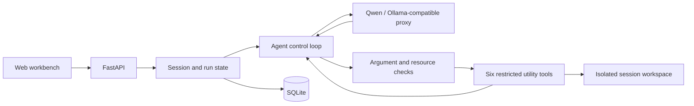

# GSCA

**General Structural Computing Agent**

GSCA is an agent for structural biology research. Its goal is to turn natural-language questions into executable, verifiable computational workflows with explicit input and output constraints. "General" refers to extensibility across structural objects, analysis tasks, and combinations of scientific tools.

**Version 0.1 provides the agent runtime and six utility tools.** It connects to Qwen and records actual actions, results, and files. Scientific task specifications, specialized structural computing tools, and domain validators have not yet been implemented.

## Scope and implementation status

| Layer | Scope | Status |
| --- | --- | --- |
| Agent runtime | Sessions, model/tool loop, budgets, cancellation, persistent state and events | Implemented |
| Utility tools | Arithmetic, time, restricted text-file operations and search | Implemented |
| Scientific task specifications | Objects, selections, units, coordinate systems, parameters, input/output contracts, acceptance criteria | Planned |
| Structural data | Sequences, PDB/mmCIF, density maps, experimental restraints, trajectories | Planned |
| Structural analysis | Quality assessment, retrieval, comparison, interfaces, pockets, interactions, docking, prediction, design | Planned |
| Experimental and dynamic analysis | Cryo-EM, crystallography, NMR, integrative modeling, dynamics, statistical analysis | Planned |
| Domain validation | Artifact checks, method applicability, uncertainty, evidence-linked conclusions | Planned |

These task families describe the intended scope, not capabilities already delivered. Each new capability requires a tool adapter, task constraints, independent validation, and reference tasks. Current uploads support UTF-8 text files up to 64 KiB; this is not general structural-file ingestion.

## Implemented features

- Multi-turn conversations, session creation and switching, and an English desktop/mobile workbench.
- Structured tool calls with inspectable requests, arguments, results, and run status.
- An isolated workspace for each session, with UTF-8 text uploads, reading, search, and result-file creation.
- SQLite persistence for messages, runs, events, and model usage, including across service restarts.
- Limits on steps, tool calls, output length, context size, and run duration, with cancellation of subsequent steps.
- Application access-code login; model credentials remain in server-side files.
- Dockerfile, Docker Compose, and a Linux user-service installer.

| Tool | Purpose |
| --- | --- |
| `calculate` | Allowlisted AST arithmetic without arbitrary code execution |
| `current_time` | Current time in a specified IANA time zone |
| `list_files` | List the current session workspace |
| `read_file` | Read UTF-8 text |
| `write_file` | Create a file without overwriting existing files |
| `search_files` | Bounded literal-text search |

Shell access, Python execution, web search, and structural biology calculations are not integrated. Scientific capabilities require tool adapters, input/output constraints, and independent validation.

## Architecture



`runtime.py` records actual actions and observations, not internal model reasoning. Local code enforces the tool allowlist and argument validation. File tools use directory file descriptors and `O_NOFOLLOW` to reject path escapes, links, special files, and overwrites.

## Requirements and model interface

- Python 3.12; pinned dependencies are listed in `requirements.txt`.
- The Docker configuration targets Linux.
- The existing model proxy must provide Ollama-format `POST /api/chat` and `GET /health` endpoints.
- Chat requests use `stream: false`, `think: false`, structured `tools`, and tool-result feedback.
- Bearer credentials are read from `MODEL_TOKEN_FILE`, never included in prompts or sent to the browser.

The adapter follows the [Ollama Chat API](https://docs.ollama.com/api/chat) and [tool-calling documentation](https://docs.ollama.com/capabilities/tool-calling). Configure a model that is installed on the model server and supports tool calling.

## Quick start: run in a user directory

```bash
git clone https://github.com/lemonral/gsca.git
cd gsca
python3 -m venv .venv
.venv/bin/python -m pip install -r requirements.txt
```

If the system Python lacks `ensurepip`, bootstrap a virtual environment in the project directory:

```bash
mkdir -p .tools
curl -fsSL https://bootstrap.pypa.io/virtualenv.pyz -o .tools/virtualenv.pyz
python3 .tools/virtualenv.pyz --app-data .tools/virtualenv-cache .venv
.venv/bin/python -m pip install -r requirements.txt
```

For direct execution, provide configuration through environment variables. `app.serve` does not automatically load `.env`:

```bash
export MODEL_BASE_URL=http://127.0.0.1:3184
export MODEL_NAME=qwen3.8:27b
export MODEL_TOKEN_FILE=/absolute/path/to/model-proxy-token
export AGENT_DATA_DIR="$PWD/data"
.venv/bin/python -m app.serve
```

Open `http://127.0.0.1:3189/`. The first launch generates an application access code in `data/access-token`. Read it in your own terminal and enter it on the login screen. This access code is separate from the model credential.

### Linux user service

```bash
.venv/bin/python scripts/install_native.py \
  --model-token-file /absolute/path/to/model-proxy-token
systemctl --user status gsca.service
```

Use `--bind-host`, `--port`, `--model-base-url`, and `--model` to configure a new installation. The installer preserves an existing `.env`, registers a service under the current account, and does not invoke sudo. To run after logout or at system startup, the host must also allow this account's systemd user services to remain active.

```bash
systemctl --user restart gsca.service
systemctl --user stop gsca.service
journalctl --user -u gsca.service -n 100 --no-pager
```

Run only one Uvicorn worker. On startup, unfinished runs become `interrupted`; the service does not automatically replay steps that may create files.

## Docker

The Dockerfile and Compose configuration have passed static configuration checks. The validation environment did not provide access to the Docker daemon, so image builds and container execution have not been verified.

1. Confirm that `docker info` succeeds.
2. Copy `.env.example` to `.env`. Set absolute credential-file paths and the runtime account's `AGENT_UID` / `AGENT_GID`.
3. Prepare the application access-code file. An initial native launch also creates it automatically:

```bash
mkdir -p data
chmod 700 data
python3 - <<'PY'
from pathlib import Path
import os, secrets
p = Path('data/access-token')
if not p.exists():
    with open(p, 'x', opener=lambda path, flags: os.open(path, flags, 0o600)) as f:
        f.write(secrets.token_urlsafe(24) + '\n')
PY
```

4. Set `APP_ACCESS_TOKEN_FILE` in `.env` to this file. Configure the model credential separately.
5. Stop this project's native service before starting the container, avoiding shared-database recovery conflicts and port contention:

```bash
systemctl --user stop gsca.service
./scripts/manage.sh up
./scripts/manage.sh status
./scripts/manage.sh logs
```

Compose uses Linux `host` networking to reach a model proxy bound to host loopback. It does not mount the Docker socket. The container runs with the configured UID/GID, a read-only root filesystem, a separate `data/` mount, and read-only credential mounts. Rootless Docker's `host` network is not necessarily the physical host network; verify model-proxy reachability separately. See the [Docker Rootless documentation](https://docs.docker.com/engine/security/rootless/).

## Try the current runtime

Create a session and enter:

> Use the calculation tool to evaluate `(123+456)*7`. Write the expression and result to `result.txt`, then read the file back to verify it.

The expected result is `4053`, accompanied by actual calculation, write, and read tool records. This loop has been verified against a real Qwen endpoint, with run records and files preserved after restart.

After uploading text, ask the agent to read, summarize, or search a named file. Individual files are limited to 64 KiB and each session workspace has a 10 MiB quota. The model context defaults to 8192 tokens. Before each request, the runtime conservatively estimates capacity from UTF-8 byte counts and reserves output space; oversized input or tool results fail explicitly to avoid implicit truncation. The file-tool limit is not the model's single-request reading capacity.

Cancellation prevents subsequent model requests and tool steps. Whether an already submitted inference stops immediately depends on the proxy and Ollama; cancellation does not guarantee immediate termination of GPU computation.

## Tests and acceptance checks

```bash
.venv/bin/python -m unittest discover -s tests -v
node --check app/static/app.js
```

The 29 automated tests cover tool boundaries, arithmetic constraints, session isolation, prevention of concurrent runs within a session, persistence and restart recovery, authentication, request-size limits, cancellation, and context limits. Real-browser checks cover login, run history, tool traces, independent sessions, chat, uploads, reloads, and mobile layout.

Run a bounded live acceptance check against your own instance:

```bash
.venv/bin/python scripts/smoke_live.py --base http://127.0.0.1:3189
```

This script creates a session and invokes the model, checking calculation, file creation, read-back verification, and the final reply. Reports are saved in the Git-ignored `verification/` directory.

## Project layout

```text
app/
  main.py       # API, login, and request boundaries
  runtime.py    # Budgeted model and tool loop
  provider.py   # Model protocol adapter
  tools.py      # Tool registry and file isolation
  store.py      # SQLite state and events
  config.py     # Configuration and application access code
  serve.py      # Server entry point
  static/       # English web workbench
scripts/
  install_native.py
  manage.sh
  smoke_live.py
tests/
Dockerfile
compose.yaml
.env.example
requirements.txt
```

The runtime `data/` directory contains the application access code, SQLite database, and session files. Git and the Docker build context exclude it. `.env`, model credentials, local dependency environments, backups, logs, and local acceptance records are also excluded.

## Extension and maintenance

Register each tool's purpose and argument schema in `tools.py`, implement a bounded executor that returns actual results and artifact paths, and add reference inputs, invalid inputs, and independent validation tests. Long-running jobs, GPU computation, and HPC execution need separate job and recovery protocols.

For backups, stop this project's service before archiving all of `data/`. SQLite uses WAL; copying only the main database file while it is running may omit state. Use the SQLite backup API for online database backups. Stop the service before restoring a complete backup and check the restored UID/GID ownership.

GSCA currently provides the runtime foundation for a general structural computing agent. Further development focuses on scientific task specifications, structural object semantics, scientific tool adapters, and domain validation. Multi-user access and distributed jobs also require separate implementation and acceptance checks.

### Response language

The interface and default replies use English. If a reply contains Chinese prose, the runtime permits one language-only rewrite with tools disabled, subject to the same step, token, and time limits. If the rewrite still violates this check, the run fails with an English error instead of presenting that reply. Exact workspace artifact paths are preserved. This script check is not a general language classifier.
