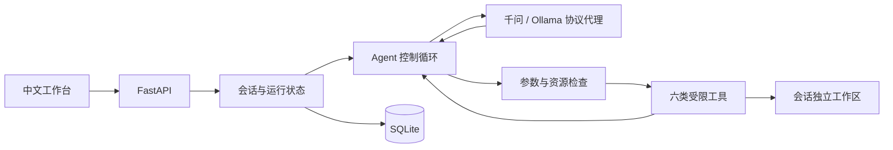

# GSCA · 通用结构计算 Agent

**作者：周熠**

**GSCA（General Structural Computing Agent）**面向结构生物学研究，目标是把自然语言问题转化为具有明确输入输出约束、可执行并可核查的结构计算流程。“通用”指跨结构对象、分析任务和工具组合持续扩展。

当前 **v0.1 实现了 Agent 运行底座和六个辅助工具**，连接千问并保存实际动作、结果与文件。结构专用工具、科学任务规格和领域验证器尚未接入。

## 项目范围与实现状态

| 层面 | 能力范围 | 当前状态 |
| --- | --- | --- |
| 运行底座 | 会话、模型与工具循环、预算、取消、状态与事件持久化 | 已实现 |
| 辅助工具 | 数学计算、时间、受限文本文件读写和检索 | 已实现 |
| 科学任务规格 | 对象、选择范围、单位/坐标、参数、输入输出与验收条件 | 待实现 |
| 结构数据接入 | 序列、PDB/mmCIF、密度图、实验约束与轨迹 | 待接入 |
| 结构分析 | 质量评估、检索、比较、界面/口袋、相互作用、对接、预测与设计 | 待接入 |
| 实验与动态分析 | cryo-EM、晶体学、NMR/整合建模、动力学与统计分析 | 待接入 |
| 领域验证 | 计算产物校验、方法适用性、不确定性与结论证据绑定 | 待实现 |

上述任务族描述持续扩展的方向，不代表现有版本已经覆盖。新增能力按工具适配、任务约束、独立验证和参考任务逐项接入。当前文本上传上限为64 KiB，尚不构成通用结构文件输入支持。

## 当前已实现功能

- 多轮对话、会话创建与切换，中文桌面及手机界面。
- 结构化工具调用，查看请求、参数、结果和任务状态。
- 每个会话独立工作区，UTF-8 文本上传、阅读、搜索和结果文件创建。
- SQLite 保存消息、运行、事件与用量，服务重启保留记录。
- 步数、工具数量、输出长度、上下文和运行时间限制，支持取消后续步骤。
- 应用访问码登录，模型凭据保留在服务端文件中。
- Dockerfile、Docker Compose，以及 Linux 用户级服务启动脚本。

| 工具 | 用途 |
| --- | --- |
| `calculate` | 白名单 AST 数学运算，不执行任意代码 |
| `current_time` | 指定 IANA 时区的当前时间 |
| `list_files` | 列出当前会话工作区 |
| `read_file` | 读取 UTF-8 文本 |
| `write_file` | 创建文件，禁止覆盖已有文件 |
| `search_files` | 有数量限制的字面文本检索 |

当前未接入 Shell、Python 执行、网页搜索或结构生物学计算。新增科学能力需要工具适配、输入输出约束和独立验证。

## 架构



`runtime.py` 保存实际动作与观察，不保存模型内部推理。工具白名单和参数校验由本地程序执行。文件工具采用相对目录 FD 与 `O_NOFOLLOW`，拒绝路径越界、链接、特殊文件和覆盖写入。

## 环境与模型接口

- Python 3.12，依赖版本见 `requirements.txt`。
- Docker 运行方式面向 Linux。
- 现有模型代理需提供 Ollama 格式的 `POST /api/chat` 和 `GET /health`。
- 对话使用 `stream: false`、`think: false`、结构化 `tools` 和工具结果反馈。
- Bearer 鉴权从 `MODEL_TOKEN_FILE` 读取，不把凭据加入提示词或前端。

接口依据 [Ollama Chat API](https://docs.ollama.com/api/chat) 和 [工具调用文档](https://docs.ollama.com/capabilities/tool-calling)。模型名可以通过配置修改，需使用实际已安装且支持工具调用的模型。

## 快速开始：个人目录运行

```bash
git clone https://github.com/lemonral/gsca.git
cd gsca
python3 -m venv .venv
.venv/bin/python -m pip install -r requirements.txt
```

若系统 Python 缺少 `ensurepip`，可在个人目录引导虚拟环境：

```bash
mkdir -p .tools
curl -fsSL https://bootstrap.pypa.io/virtualenv.pyz -o .tools/virtualenv.pyz
python3 .tools/virtualenv.pyz --app-data .tools/virtualenv-cache .venv
.venv/bin/python -m pip install -r requirements.txt
```

直接运行时，通过进程环境配置模型；`app.serve` 不自动解析 `.env`：

```bash
export MODEL_BASE_URL=http://127.0.0.1:3184
export MODEL_NAME=qwen3.8:27b
export MODEL_TOKEN_FILE=/absolute/path/to/model-proxy-token
export AGENT_DATA_DIR="$PWD/data"
.venv/bin/python -m app.serve
```

打开 `http://127.0.0.1:3189/`。首次启动会生成应用访问码 `data/access-token`，在自己的终端读取并填入登录框。该访问码与模型凭据不同。

### Linux 用户服务

```bash
.venv/bin/python scripts/install_native.py \
  --model-token-file /absolute/path/to/model-proxy-token
systemctl --user status zhouyi-gsca.service
```

可用 `--bind-host`、`--port`、`--model-base-url`、`--model` 修改新配置。脚本保留已有 `.env`，在当前账号注册用户单元，不调用 sudo。需要随开机运行时，服务器还须允许该账号的 systemd 用户服务在退出登录后继续运行。

```bash
systemctl --user restart zhouyi-gsca.service
systemctl --user stop zhouyi-gsca.service
journalctl --user -u zhouyi-gsca.service -n 100 --no-pager
```

只能启动一个 Uvicorn worker。服务启动会把未结束运行标为 `interrupted`，不自动重放可能产生文件副作用的步骤。

## Docker

Dockerfile 和 Compose 已提供并通过静态配置检查。当前验证环境未获得 Docker daemon 使用权限，因此没有完成镜像构建和容器运行验证。

1. 确认 `docker info` 可用。
2. 复制 `.env.example` 为 `.env`，设置凭据文件的绝对路径，以及 `AGENT_UID` / `AGENT_GID`。
3. 准备应用访问码文件，首次原生启动也会自动生成：

```bash
mkdir -p data
chmod 700 data
python3 - <<'PY'
from pathlib import Path
import os, secrets
p = Path('data/access-token')
if not p.exists():
    with open(p, 'x', opener=lambda path, flags: os.open(path, flags, 0o600)) as f:
        f.write(secrets.token_urlsafe(24) + '\n')
PY
```

4. `.env` 中 `APP_ACCESS_TOKEN_FILE` 指向此文件；模型凭据单独指定。
5. 停止同项目的原生服务，再启动容器，避免共用数据库或争用端口：

```bash
systemctl --user stop zhouyi-gsca.service
./scripts/manage.sh up
./scripts/manage.sh status
./scripts/manage.sh logs
```

Compose 使用 Linux `host` 网络访问主机回环地址上的模型代理，不挂载 Docker socket。容器以指定 UID/GID 运行，根文件系统只读，`data/` 单独挂载，凭据只读挂载。Rootless Docker 的 `host` 网络不一定等同物理主机网络，需要独立验证代理可达性，详见 [Docker Rootless 文档](https://docs.docker.com/engine/security/rootless/)。

## 当前底座的使用与验证

新建会话并输入：

> 请调用计算工具计算 `(123+456)*7`，把表达式和结果写入 `result.txt`，然后读回文件核对。

应得到 `4053`，以及计算、写入、读回的实际工具记录。该闭环已经在真实千问接口上验证，重启后记录和文件仍保留。

上传文本后可让 Agent 阅读、总结或检索指定文件。单文件最大 64 KiB，会话写入配额 10 MiB。模型上下文默认 8192 tokens，调用前以 UTF-8 字节数保守估计并预留输出空间；过大的输入或工具结果会明确失败，防止隐式截断。文件工具上限不等于模型一次可读取的容量。

取消阻止后续模型请求和工具步骤，已发出的推理是否立即停止取决于模型代理及 Ollama；不能据此承诺 GPU 计算立即终止。

## 测试与验收

```bash
.venv/bin/python -m unittest discover -s tests -v
node --check app/static/app.js
```

25项自动测试覆盖工具边界、数学约束、会话隔离、活动任务防重、持久化与重启恢复、鉴权、请求大小、取消和上下文限制。真实浏览器验证覆盖登录、历史轨迹、独立会话、对话、上传、刷新与手机布局。

用自己的运行实例做有界模型验收：

```bash
.venv/bin/python scripts/smoke_live.py --base http://127.0.0.1:3189
```

该脚本会创建新会话并调用模型，检查计算、写入、读回及最终答复；报告写入被 Git 忽略的 `verification/`。

## 项目结构

```text
app/
  main.py       # API、登录、请求边界
  runtime.py    # 有预算的模型与工具循环
  provider.py   # 模型协议适配
  tools.py      # 工具注册与文件隔离
  store.py      # SQLite 状态及事件
  config.py     # 配置和应用访问码
  serve.py      # 启动入口
  static/       # 中文工作台
scripts/
  install_native.py
  manage.sh
  smoke_live.py
tests/
Dockerfile
compose.yaml
.env.example
requirements.txt
```

运行目录 `data/` 包含应用访问码、SQLite 数据库和会话文件，已从 Git 和 Docker 构建上下文排除。`.env`、模型凭据、个人依赖环境、备份、日志和本地验收记录也不提交。

## 扩展与维护

在 `tools.py` 注册工具用途与参数 schema，实现受限执行器并返回实际结果和产物路径，再补参考输入、错误输入和独立验证测试。长作业、GPU或HPC执行需要单独的作业协议与恢复机制。

备份时先停止本项目服务，再整体归档 `data/`。SQLite 使用 WAL，运行中仅复制数据库主文件可能遗漏状态；在线备份应使用 SQLite backup API。恢复前停止服务，恢复完整数据并检查所属 UID/GID。

GSCA 当前交付的是通用结构计算 Agent 的运行底座。后续开发围绕科学任务规格、结构对象语义、计算工具适配与领域验证推进；多用户与分布式作业也需要单独实现和验收。
